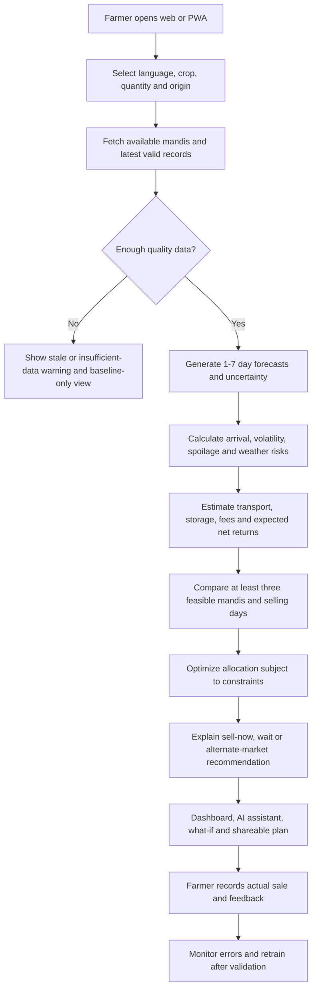
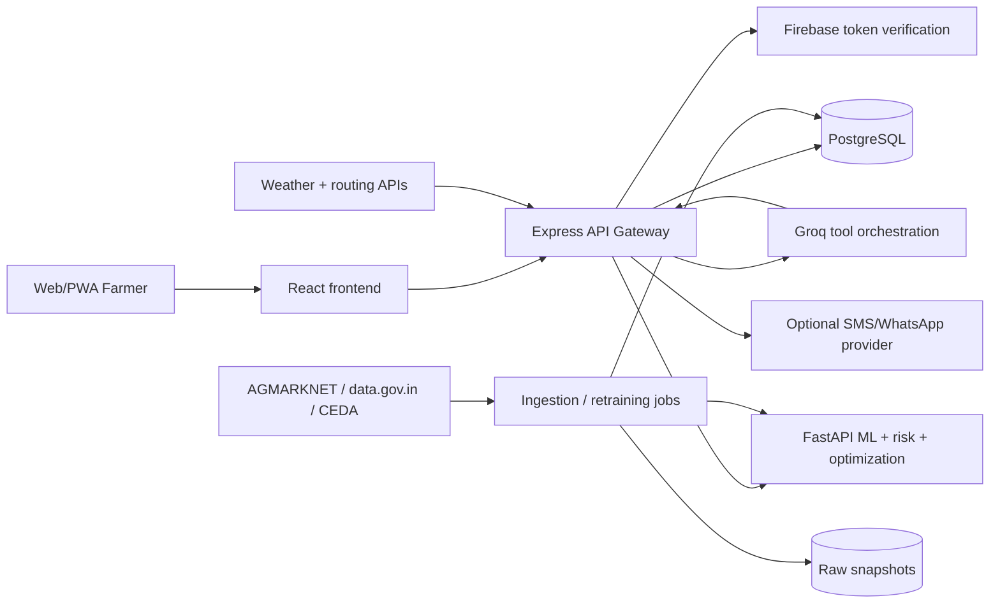

# FASALYTICS — Master Project Blueprint

> **Project:** AI Market and Risk Intelligence for Agri Supply Chains  
> **Hackathon:** SYRUS 7.0 | **Team:** CodeSparks Innovators  
> **Domain:** Sustainability / Agriculture Technology  
> **Document type:** Engineering specification, phased implementation plan, and improvement roadmap  
> **Version:** 1.3 | **Updated:** 18 October 2026 (v1.3: Phase 1 implementation status and recorded decisions added, §0.2; no requirement was changed. v1.2: nationwide, all-crop scope made a core architectural requirement, §0.1)  
> **Status:** Proposed architecture and implementation plan. Sections other than §0.2 describe the design, not completed functionality. What has actually been built and verified is recorded only in §0.2.

---

## 0. How to use this document

This is the central implementation guide for building FASALYTICS **from scratch**. It combines requirements from the original PS2 statement and the team's project documents with **proposed engineering decisions**. The source documents define the product vision, not a verified current implementation. Engineering details such as database schemas, API contracts, formulas, thresholds, schedules, and infrastructure choices below are **design proposals** to validate during implementation.

**Source basis:**

1. `Sustainability_PS_2_Syrus7.0.pdf` — original PS2 requirements: market data, 1–7-day forecasting, comparison of ≥3 mandis, net returns, explainable risks, LLM with real tools, scenarios, responsive dashboard.
2. `Sustanability_PS2_CodeSparks-Innovators_Neilsen Vaz.pdf` — presentation: farmer journey, proposed architecture, innovation and showstopper emphasis on Smart Harvest Allocation.
3. `Sustainability_PS-2_CodeSpark-Innovators_NeilsenVaz.pdf` — final concept: crowd-aware recommendations, fair price card, two-way SMS, multilingual/voice access, feedback loop, weather intelligence, proposed tech stack.

**Status conventions:** `MUST` = essential for PS2 MVP; `SHOULD` = strong hackathon differentiator; `LATER` = enhancement requiring more time/data/integration. `Verified` is reserved for functionality actually tested and demonstrated.

## 0.1 Platform scope: nationwide and all-crop (core architectural requirement)

FASALYTICS is a **nationwide, all-commodity platform**, not a Maharashtra or two-crop product.

- **Geography:** India → State/UT → District → Mandi, with canonical identifiers. No state, district or market may be hardcoded in application logic, configuration or schemas.
- **Commodities:** India's full set of agricultural commodities and varieties, **discovered dynamically from data**. No crop names in business logic. Adding a commodity or market must not require code changes.
- **Reusable pipelines:** one ingestion, normalisation, forecasting, risk, comparison and allocation pipeline parameterised by commodity and market. No per-crop applications.
- **Capability is evidence-gated, not whitelisted.** Architectural support for every crop and mandi is a design requirement. Whether a given commodity–market combination receives validated forecasts is decided by **measurable data and backtesting criteria** (§4.2.1). Insufficient data produces an honest, lower capability tier, never a fabricated forecast.
- **Early validation cases** (for example Potato and Onion in Maharashtra, where the supplied historical files have good continuity) exist only to prove the pipeline. They are **not** product limits and must not be encoded in models, schemas or UI.
- **Granularity honesty:** mandi-level, state-level and national observations are different things and must never be blended to create misleading values (for example, state-level arrivals are never presented as mandi arrivals).

### Non-negotiable principles

- **No invented market observations.** Demo/synthetic records must be tagged and excluded from real-data metrics.
- **No false live-data claims.** Show `observed_at`, `ingested_at`, source, and freshness; recent does not necessarily mean real time.
- **No LLM-generated numerical decisions.** Forecasting, costs, optimization, and scenarios are computed by deterministic or trained services; the LLM interprets results.
- **No leakage.** Training and evaluation only use information that would have been available at the prediction cutoff.
- **No guaranteed profit claims.** All recommendations are estimates with risks, assumptions, and possible deviations.
- **Build vertical slices.** Complete a real crop → market data → forecast → comparison → recommendation workflow before expanding channels.
- **Stitch-first frontend.** When Google Stitch HTML/CSS/assets are supplied, treat them as the primary UI design source. Preserve their intended visual language while converting to maintainable React and connecting real services. Never claim exported HTML alone provides backend functionality.

## 0.2 Implementation status and recorded decisions (updated 18 October 2026)

This section is the only place that states what exists. Everything else in this document remains the
design. "Verified" below means executed and observed, with results in the milestone reports.

### Phase 1 (foundation): implemented and verified locally; first GitHub Actions run pending

| Phase 1 task (§10) | State |
|---|---|
| 1. Early technical-validation series, journeys, priorities | Dataset profiling done (`docs/data-sources/DATASET_COVERAGE.md`). Potato and Onion in Maharashtra remain **technical-validation examples only**, never the supported scope. |
| 2. Repository and branch policy | Written: `docs/process/REPOSITORY_POLICY.md`. GitHub branch protection must still be enabled by a maintainer. |
| 3 / 3a. Initialise React, Express, FastAPI; inventory Stitch exports | Done. Originals preserved under `design/stitch/original/`; inventory, design tokens and gaps documented. |
| 4. PostgreSQL, migrations, Docker Compose, `.env.example`, `.gitignore` | Done. PostgreSQL 17 in Compose with named volume `fasalytics_pgdata`; Drizzle migrations; least-privilege roles (admin, migrator, app). |
| 5. Typed contracts, centralised validation, error responses | Done for the existing endpoints: OpenAPI 3.1 in `docs/api/` checked by tests; one error contract in both services; config validation names variables, never values. No body-accepting endpoint exists yet. |
| 6. Formatting, linting, test runners, GitHub Actions | Done. ESLint/Prettier, Ruff, Vitest, pytest, JSDoc type checking. Workflow `.github/workflows/ci.yml` passes `actionlint` and its database job was simulated locally; **it has not run on GitHub yet**. |
| 7. `/health`, `/ready`, cross-service request ID, CORS | Done. Express `/health` (liveness), `/health/dependencies`, `/ready` (200 only when configured dependencies are healthy); FastAPI `/health` and `/ready` (503 until validated models exist). `X-Request-Id` is validated and forwarded Express to FastAPI. |
| 8. Threat model and credential policy | Written: `docs/security/THREAT_MODEL.md`, `CREDENTIAL_POLICY.md`; controls marked implemented or planned. |

Phase 1 exit criteria: a clean checkout reproduces the environment (**verified** on an isolated copy with its
own database, ports and volume) and a failed dependency gives an informative status (**verified** live for
PostgreSQL and FastAPI outage and recovery). CI executing the tests on GitHub is the remaining criterion.

### Frontend integration sprint (standalone, before Phase 2)

The eight Stitch screens (Dashboard, Market Explorer, Commodities, Forecasting, Mandi Comparison, Harvest
Allocation, What-If Simulator, AI Copilot) are converted into responsive React/JavaScript pages in
`apps/web`, with a Profile placeholder and the System Status page kept as diagnostics. The Dashboard is the
landing page. **They are UI previews:** layout, navigation, tokens and non-data interactions (menus, dialogs,
tabs, accordions, input state, scenario levers) work; every price, forecast, comparison, allocation,
simulation and assistant answer is an explicit "unavailable" state, because the ingestion pipeline, registries,
models and engines do not exist. Sample values in the Stitch exports are never shown, selectors offer no
placeholder commodity/state/market lists, and unavailable actions are disabled with a stated reason. Data
enters each page through one hook in `apps/web/src/services/agri/index.js` so Phase 2+ can connect real
Express endpoints without rewriting the pages. Route map, component inventory and per-screen API needs:
`apps/web/README.md`.

**Not started:** Phase 2 and later. There are no agricultural tables, no dataset imports (the four files in
`data/raw/` are untouched), no market APIs, no models, no forecasts, no risk engine, no simulation and no AI copilot.

### Decisions recorded during Phase 1

| Topic | Decision |
|---|---|
| ORM / migrations (§5.1) | **Drizzle ORM + drizzle-kit**, JavaScript. The Express API uses `pg` directly with one bounded pool; no ORM is needed for its health probe. |
| Languages | JavaScript/JSX (React) and JavaScript ES modules (Express) with JSDoc type checking via `tsc -p jsconfig.json`; Python only in `services/intelligence`. No TypeScript application files. |
| Python tooling | Ruff for linting and formatting; **Black is not used** (§10 Phase 1 task 6 lists "Ruff/Black"). |
| Database roles | `fasalytics_admin` (bootstrap only), `fasalytics_migrator` (migrations only), `fasalytics_app` (DML only; the only role the API may use). Migrations are explicit, never run at API startup. |
| Network exposure | Only `web` (5173), `api` (4000) and `db` (host 5433) are published, all on `127.0.0.1`. FastAPI is reachable only inside the Compose network at `intelligence:8000`; Express uses that name, never localhost, inside Compose. An unrelated PostgreSQL on host port 5432 is never used. |
| Readiness semantics | Express `/ready` reflects the API's dependencies. FastAPI model readiness is answered only by FastAPI `/ready` and echoed separately by Express (`forecasting_models`, never gating); it is never inferred from `/health`. |
| Probe contract | PostgreSQL probe reports `healthy` only after `SELECT 1` succeeds; failures are `unreachable` with reason `timeout`, `connection_failed`, `authentication_failed` or `query_failed`. A stopped database container typically yields `timeout`. |
| API contract format | OpenAPI 3.1 **JSON** in `docs/api/` (Express hand-written and contract-tested; FastAPI generated and staleness-tested), instead of the `openapi.yaml` suggested in Appendix B. |
| Secrets in Docker | The API container receives the application-role `DATABASE_URL` as an environment variable (visible to local Docker users). Accepted for local development only; a secret store is required for any shared environment. |
| Temporary local override | On the current development machine a host-run FastAPI uses port 8001 because 8000 is occupied by an unrelated process. This is a git-ignored local setting, not a project decision. |

### Open items before closing Phase 1

1. First successful GitHub Actions run on a pull request (all five jobs).
2. Enable branch protection and required checks on `main` (a GitHub setting).
3. Decide what to do about the reference PDF that was committed and then removed from the repository (it
   remains in earlier Git history).

---

# 1. Executive overview

## 1.1 Problem

Farmers face volatile mandi prices, fragmented price/arrival records, transport and handling costs, perishability, and uncertainty about where and when to sell. Choosing the highest listed price is often inferior to choosing the **highest feasible net return after logistics and risk**. Farmers need comprehensible, locally relevant, source-backed guidance.

## 1.2 Proposed solution

FASALYTICS is a mobile-first agricultural decision-support system. A farmer specifies **crop, quantity, origin, desired selling horizon, and constraints**. The system retrieves timestamped mandi records, forecasts modal prices for the next 1–7 days, evaluates market and spoilage risks, compares at least three mandis, and proposes a sell-now/wait/alternative-market action. Its signature innovation, **Smart Harvest Allocation**, can distribute harvest across multiple markets when the expected risk-adjusted benefit outweighs extra logistics costs.

It also aims to provide a Fair Price Card, arrival-aware recommendations, a tool-connected Groq LLM assistant, what-if simulation, Marathi/Hindi/English support, a PWA, alerts, and eventually two-way SMS/WhatsApp and voice.

## 1.3 Primary users

- **Smallholder farmer:** quick decision, large buttons, low-data usage, vernacular explanation.
- **Farmer Producer Organization (FPO)/cooperative:** bulk quantity, multi-mandi allocation, exportable comparison.
- **Trader/aggregator:** planning and market comparison (separate permissions/ethics as product matures).
- **Administrator/data steward:** source status, ingestion failures, quality reports, model evaluation.

## 1.4 MVP scope vs extended scope

| Capability | Priority | MVP acceptance |
|---|---|---|
| Historical/recent mandi prices and arrivals | MUST | Source-tracked records for a documented crop/mandi/date coverage set |
| 1–7-day price forecasting | MUST | Backtested forecasts with errors and availability warnings |
| Compare ≥3 mandis | MUST | Side-by-side estimated net returns with cost assumptions |
| Sell now / wait / switch market | MUST | Recommendation with numeric evidence and uncertainty |
| Risk intelligence | MUST | Volatility, arrival change, data freshness, forecast reliability |
| Responsive dashboard | MUST | Working mobile and desktop flow |
| Tool-grounded LLM + scenario analysis | MUST | Tool calls, validation, and recalculated outputs |
| Smart Harvest Allocation | SHOULD | Constrained allocation with baseline comparison |
| Fair Price Card | SHOULD | Source-backed indicative range, not a guaranteed price |
| Crowd-aware market pressure | SHOULD | Honest proxy based on arrivals; no claim to know all farmer intentions |
| PWA, Hindi/Marathi, weather | SHOULD | Tested UI translations/offline shell and labelled weather signals |
| Voice, SMS, WhatsApp, push alerts | LATER | Provider-approved and opt-in integration |
| Farmer outcome feedback | SHOULD | Store realized sale; compare against predictions |

**Explicit non-goals for initial MVP:** actual commodity trading or payments, guaranteed realized prices, fully autonomous sales, universal India-wide coverage, real-time congestion prediction without real-time data, offline forecasting without cached data, and regulatory-grade financial advice.

## 1.5 Success criteria

1. Farmer can complete a recommendation flow on a mobile browser in a few steps.
2. Every displayed price/forecast includes source and as-of information.
3. At least three mandis are compared when sufficient valid data exists; otherwise explain coverage gaps.
4. Forecasting is compared against a naive baseline on **unseen future periods**.
5. Cost and allocation calculations reproduce in unit tests.
6. The AI assistant never fabricates a numeric market recommendation when tools fail.
7. A recorded demo works with explicitly labelled frozen real-data snapshots even if external services fail.

---

# 2. Product workflow



### Example farmer journey (illustrative, NOT observed market data)

1. Farmer selects **Tomato**, **100 quintals**, origin **Pune district**, sale within **3 days**.
2. App returns eligible mandis with last-observed timestamps.
3. Forecast service returns day-specific estimates and uncertainty for each market.
4. Cost engine estimates truck/fuel/handling, potential storage and spoilage.
5. Comparison ranks expected **net** returns rather than raw prices.
6. Allocation engine proposes a split only if constraints and risk-adjusted gain justify it.
7. Farmer asks, “What if diesel/transport increases 20%?” The simulator recomputes costs, ranks, and allocation; the Groq assistant explains the changed figures.
8. Farmer optionally saves the plan and later enters actual transaction results.

---

# 3. Eight functional modules and feature inventory

## Module 1 — Farmer management and interface

**Features:** sign-in/optional guest exploration, farmer profile, language, crop/quantity/origin entry, dashboard, responsive PWA, saved preferences.

**UI screens:** landing; onboarding/login; farmer dashboard; profile/settings. **Backend:** Firebase ID token verification in Express; PostgreSQL user/profile/preferences; role checks. **Edge cases:** no GPS permission, invalid quantity, no account, low bandwidth, screen reader access. **Output:** a validated recommendation request.

## Module 2 — Market data intelligence

**Features:** historical and recent minimum/maximum/modal prices, arrivals, source tracking, ingestion, cleaning, freshness, filters, quality dashboard.

**UI:** historical line chart, arrival bars, commodity/state/district/mandi/date filters, source badge. **Backend:** scheduled source adapters, raw storage, normalization, quality rules, canonical market IDs. **Output:** queryable trusted observations with provenance.

## Module 3 — AI forecasting

**Features:** 1–7-day forecasts per crop/mandi, lag/rolling/seasonal/arrival features, uncertainty, error metrics, model fallback.

**UI:** observed versus forecast chart, seven horizon cards, reliability note. **Backend:** FastAPI inference, versioned model artifacts, training/evaluation jobs. **Output:** timestamped forecast with model version and uncertainty status.

## Module 4 — Mandi comparison and net returns

**Features:** compare ≥3 mandis, distance, transport, storage, spoilage, fees, sell-now/wait/switch, breakdown of net earnings.

**UI:** market cards, comparison table, map, editable assumptions. **Backend:** distance/routing adapter, tariff estimator, revenue calculator. **Output:** ranked feasible selling choices and full cost audit.

## Module 5 — Risk and weather

**Features:** price volatility, arrival spikes, downside scenarios, perishability, forecast reliability, stale data, optional weather/route warnings, alerts.

**UI:** risk severity chips, explanations, weather summary. **Backend:** rule-based risk signals initially; calibrated probabilistic risk only with evidence. **Output:** transparent signals and actionable cautions.

## Module 6 — Smart allocation and market optimization

**Features:** harvest splitting, market capacity constraints, truck minimums, risk tolerance, arrival-aware penalties, Fair Price Card.

**UI:** allocation donut, quantity sliders, baseline-vs-optimized returns, rationale. **Backend:** mathematical optimization using SciPy or mixed-integer solver; no LLM arithmetic. **Output:** feasible quantity allocation, net return, uncertainty, and reason codes.

## Module 7 — AI copilot and scenario simulator

**Features:** Groq tool-calling assistant, source citations, explanations, transport/price/arrival/spoilage what-if scenarios, multilingual answers, optional voice.

**UI:** chat with result cards and side-by-side scenarios. **Backend:** validated tool registry and orchestration, bounded inputs, structured responses. **Output:** reproducible scenario ID and data-grounded explanation.

## Module 8 — Communication, feedback and operations

**Features:** opt-in SMS/WhatsApp, alerts, saved decisions, realized sales and feedback, monitoring, deployment, privacy, testing.

**UI:** notifications, history, feedback form. **Backend:** message provider webhooks, job queue, consent store, audit logs, observability. **Output:** monitored product and outcome evidence.

---

# 4. Data sourcing: where information comes from

## 4.1 Proposed source hierarchy

| Source | Intended data | Acquisition route | Caveat / verification step |
|---|---|---|---|
| **AGMARKNET** (Government of India) | Market-wise daily min/max/modal prices and arrivals where available | Official published downloads/portal or authorized dataset interface | Confirm accessible format, coverage, timestamps, reuse conditions, and limits before coding |
| **data.gov.in** | Government datasets including commodity prices/arrivals | Catalog download or documented API if a suitable resource and access key exist | Resource IDs, schema, update cadence, quotas and coverage vary; do not assume one universal API |
| **CEDA Agri-Market Data** | Historical mandi price and arrival series | Available download/access mechanism subject to terms | Confirm permitted access, granularity and freshness; may be best for historical training |
| **Official meteorological / weather provider** | Forecast rainfall, temperature, severe weather | Documented provider API | Forecasts are not proof of future price changes; note provider/forecast issue time |
| **Routing provider** | Origin-to-mandi road distance/time | Google Maps Routes, OpenRouteService, OSRM or equivalent subject to licensing | Routing can be paid, rate-limited, inaccurate for truck restrictions |
| **Farmer-entered inputs** | Quantity, origin, crop grade, expected storage and costs | Form / chat / SMS | Self-reported; keep separate from verified market observations |
| **Farmer sale feedback** | Actual quantity, price, fees, date, market | Consent-based feedback form | Selection bias and verification limitations; never treat as official mandi quote |

**Useful starting links (verify current availability and terms):** [AGMARKNET](https://agmarknet.gov.in/), [data.gov.in](https://www.data.gov.in/), [CEDA](https://agri-market-data.ceda.ashoka.edu.in/). These are **candidate sources**, not assertions that live API credentials, data downloads or licenses are already secured.

## 4.2 Coverage strategy: nationwide platform, evidence-gated capability

The platform targets **all of India and all commodities** (§0.1). The data supplied so far is a historical subset, so coverage is **measured, never assumed**.

**Three separate notions must not be confused:**

| Concept | Meaning | Source of truth |
|---|---|---|
| **Platform coverage** | What the architecture can represent: any state, district, mandi, commodity, variety | Schemas and registries (no hardcoding) |
| **Dataset coverage** | What the ingested files actually contain, per source, granularity and period | Coverage matrix generated from data |
| **Forecast eligibility** | Which commodity–market (or commodity–state) series are validated for forecasting | Automated criteria plus backtests (§4.2.1) |

**Coverage matrix (generated, not hand-written):** source × state × district × market × commodity × variety × granularity × start/end dates × observation count × arrivals completeness × gaps × latest date. Markets are keyed by canonical IDs, not names (the same market name occurs in several states).

**Early technical validation:** use well-covered series (for example Potato and Onion in Maharashtra) to prove ingestion, features, backtesting and API contracts end to end. Then run the **same** pipeline over every series that passes eligibility. Prefer coverage and continuity over breadth *within* a tier. Do not train on sparse series to claim coverage.

### 4.2.1 Capability tiers (determined by measurable criteria)

| Tier | Meaning | Typical evidence |
|---|---|---|
| **Full Intelligence** | Validated mandi-level forecasts and decision support | Sufficient mandi-level history, continuity, freshness and backtest skill over baseline |
| **Limited Intelligence** | Historical mandi data exists, but quality or coverage is insufficient for validated forecasts | Gaps, short history, stale data or no skill over baseline |
| **State-Level Intelligence** | Only state-level observations exist; state analysis only | State × commodity series (never presented as mandi-level) |
| **Insufficient Data** | Not enough verified observations | Below minimum counts or too stale |

Criteria (observation count, span, continuity/maximum gap, missingness, freshness, horizon, backtest skill, uncertainty) are configuration values stored with the evaluation, not commodity whitelists. The first, provisional data-sufficiency screen and its results are recorded in `docs/data-sources/DATASET_COVERAGE.md`; **only Phase 3 backtests can grant forecast eligibility**.

### 4.2.2 Historical versus recent data

The supplied datasets are **historical**. Current decision support requires a recent feed (verified in Phase 2). Without recent observations the system supports historical exploration and backtesting but must disable or qualify current recommendations and label every value with its reporting date.

## 4.3 Source adapter contracts

Each provider gets an adapter: `discover()`, `fetch(start, end, commodity, state)`, `parse(raw)`, `normalize()`, `validate()`, `persist()`. Adapters must support pagination/retries with backoff, checkpoints, rate limits, idempotent upserts, and structured failure logs. Never scrape sites in violation of their terms or access controls.

Raw data is immutable (with source URL, retrieval timestamp, checksum, license/terms note). Cleaned data is stored separately. Preserve original units and strings for traceability.

## 4.4 Canonical observation schema

```text
observation_id             UUID
source_id                  source identifier
source_record_key          provider record key / dedupe hash
observed_date              DATE in market local time
geo_granularity            market / state / national   (never blended across levels)
temporal_granularity       daily / monthly
state_id                   canonical UUID
district_id                nullable canonical UUID (null for state/national records)
market_id                  nullable canonical UUID (null for state/national records)
commodity_id               canonical UUID
source_file                original filename (provenance)
is_historical_snapshot     BOOLEAN (true for supplied historical files)
variety                    nullable string
grade                      nullable string
min_price_inr_per_quintal   NUMERIC nullable
max_price_inr_per_quintal   NUMERIC nullable
modal_price_inr_per_quintal NUMERIC nullable
arrival_quantity_tonnes    NUMERIC nullable
source_price_unit          string
source_arrival_unit        string
source_url                 nullable string
source_published_at        nullable timestamp
retrieved_at               timestamp
quality_status             accepted / flagged / rejected
quality_flags              array / JSON
is_synthetic               BOOLEAN default false
```

**Units:** 1 quintal = 100 kg; 1 metric tonne = 10 quintals. A price expressed in ₹/tonne is divided by 10 to convert to ₹/quintal. Preserve nulls rather than silently converting missing arrivals to zero.

## 4.5 Data quality checks

- Required keys: source, date, commodity, mandi, and at least one price field.
- Nonnegative prices and arrivals; flag zero modal prices unless the source semantics explicitly allow them.
- If all prices are present, normally `min ≤ modal ≤ max`; flag violations for review.
- Duplicate detection by provider ID or `(source, market, commodity, variety, grade, date)`; reconcile competing sources without blindly averaging.
- Missing-day detection distinguishes **market closure/no reporting** from zero arrivals.
- Outlier detection using rolling median/MAD or domain-informed thresholds; **flag** rather than automatically delete genuine price shocks.
- Unit checks and inconsistent commodity/market spellings.
- Freshness based on last observation, not latest download time.
- Coverage and quality score used to determine whether a model is eligible.

## 4.6 Historical vs recent ingestion

**Historical bootstrap:** obtain permitted bulk files; load to `data/raw/source/date/`; checksum; normalize; audit coverage; upsert into DB; generate a data-quality report. **Incremental updates:** schedule once daily or aligned to provider publication cadence; fetch overlapping recent days (e.g. last 7–14) to capture revisions; idempotently upsert; invalidate affected forecasts; log discrepancies. Frequency is configurable and **must not imply that sources update daily**.

## 4.7 Data leakage and availability timestamps

Training features must reflect what was *published/known at forecast time*. A historical observation dated Monday but published Wednesday cannot be treated as available Monday for a Tuesday forecast. Where publication history is unavailable, document the approximation and evaluate conservatively. Forecast future arrivals separately or use lagged arrivals; never use realized future arrivals as features.

---

# 5. Technical architecture

## 5.1 Recommended stack

| Layer | Initial choice | Why |
|---|---|---|
| Web | React + Vite + JavaScript (JSX) | Fast iteration; contracts documented with JSDoc |
| UI | Tailwind CSS + accessible component library | Mobile-first, consistent patterns |
| Charts | Recharts | Forecast, arrivals, risk visuals |
| Main API | Node.js + Express (JavaScript, ES modules) | Auth, orchestration, public REST endpoints |
| Database | PostgreSQL | Relational records, auditability, transactions |
| ORM/migrations | Drizzle ORM + drizzle-kit (chosen in Phase 1, see §0.2) | Schema evolution and typed queries |
| ML API | Python + FastAPI + Pydantic | Validation, forecasting, optimization |
| Modeling | Pandas, scikit-learn, XGBoost | Feature engineering and tabular time series |
| Optimization | SciPy; optional OR-Tools/PuLP | Constrained allocation and routing decisions |
| Auth | Firebase Auth | Token-based login, provider-dependent OTP |
| LLM | Groq API | Tool-calling conversational layer |
| Languages | UI i18n; optional Sarvam | Marathi/Hindi, optional speech |
| Jobs | Cron initially; queue/worker later | Ingestion, retraining, alerts |
| Storage | Object storage or versioned local files | Raw snapshots, model artifacts |
| Hosting | Frontend static host + API/ML containers + managed PostgreSQL | Independent scaling |

The project proposal also mentioned Next.js alternatives. **Pick one per layer** for the first implementation; do not implement multiple competing frameworks without need.

## 5.2 Service diagram



**Trust boundary:** browser never calls secret-bearing ML/LLM/provider endpoints directly. Express validates Firebase tokens, input and permissions, and applies rate limits. FastAPI is internal or authenticated. Provider secrets remain server-side.

## 5.3 Proposed monorepo

```text
fasalytics/
  apps/
    web/                   # React/Vite (JavaScript/JSX)
    api/                   # Express (JavaScript, ES modules)
  services/
    intelligence/          # FastAPI inference, risk, costs, optimization
    data-pipeline/         # source adapters, ETL, quality reports
  packages/
    contracts/             # OpenAPI / shared schemas and generated clients
    ui/                    # optional shared UI components
  database/
    migrations/
    seeds/
  data/
    raw/                   # gitignored, manifest tracked
    processed/             # gitignored
    demo/                  # explicitly labeled fixture data
  models/
    registry/              # metadata; artifacts stored securely
  tests/
    integration/
    end-to-end/
  docs/
    architecture/
    decisions/
    data-sources/
  infra/
    docker/
    deployment/
  .github/workflows/
  .env.example
  docker-compose.yml
  PROJECT.md
  README.md
```

## 5.4 Key relational tables

`users`, `farmer_profiles`, `commodities`, `markets`, `market_aliases`, `data_sources`, `market_observations`, `ingestion_runs`, `data_quality_events`, `weather_snapshots`, `route_estimates`, `model_versions`, `forecast_runs`, `forecast_points`, `risk_assessments`, `cost_assumptions`, `recommendation_runs`, `mandi_comparisons`, `allocations`, `scenario_runs`, `chat_sessions`, `chat_messages`, `alerts`, `notification_consents`, `sale_feedback`, `audit_events`.

Important keys/indexes:
- Unique source observation identity for idempotency.
- Composite `(commodity_id, market_id, observed_date DESC)` for time-series reads.
- Forecast keyed by `run_id, market_id, horizon` and linked to model/data snapshot.
- Recommendation stores **all assumptions and computed components**, not only a final sentence.
- Personal data separated from public market data; use least privilege and retention policies.

## 5.5 Example API contracts (proposed)

| Route | Input | Output |
|---|---|---|
| `GET /api/v1/commodities` | optional query | supported crop list |
| `GET /api/v1/markets` | crop, location, radius | eligible mandis, coverage, coordinates |
| `GET /api/v1/prices` | crop, market, from, to | timestamped observations and source |
| `POST /api/v1/forecasts` | crop, markets, cutoff, horizons | predicted modal price and uncertainty |
| `POST /api/v1/risks` | crop, markets, forecast refs | risk signals and reasons |
| `POST /api/v1/compare` | crop, quantity, origin, markets, dates, costs | ranked net-return options |
| `POST /api/v1/allocate` | comparison ref, constraints, risk tolerance | optimized allocation and baseline |
| `POST /api/v1/scenarios` | baseline ref, bounded parameter changes | recalculated result and delta |
| `POST /api/v1/chat` | session, user message | tool-backed response, source refs |
| `POST /api/v1/feedback` | actual sale details | saved outcome and forecast comparison |
| `GET /api/v1/health` | none | service readiness |

Example normalized recommendation response:

```json
{
  "recommendation_id": "rec_demo_001",
  "status": "illustrative",
  "commodity": "tomato",
  "quantity_quintals": 100,
  "as_of": "EXAMPLE_TIMESTAMP_NOT_LIVE",
  "best_action": "compare_options",
  "markets_compared": 3,
  "currency": "INR",
  "net_return_estimate_inr": null,
  "risk_level": "unknown_until_computed",
  "data_freshness": "demo_only",
  "reasons": [],
  "warnings": ["Example schema, not a market prediction"]
}
```

## 5.6 Core service behavior

- Use consistent schema versioning and `request_id` across services.
- Validate commodity, market IDs, quantities, dates, currencies and units at each boundary.
- Set timeouts and circuit breakers; fall back to a clearly marked baseline or unavailable state.
- Cache immutable historical queries; invalidate current views when corrected data arrives.
- Separate `observed`, `forecast`, `scenario`, and `farmer_reported` values in the UI and API.
- Store deterministic tool outputs for reproducibility and auditing.

---

# 6. Detailed implementation: price forecasting

## 6.1 Prediction target

For each eligible `(commodity, mandi, variety/grade)` series and horizon `h ∈ {1,…,7}`, predict future **modal price in INR/quintal**. If source reports no observation for a calendar day, define and document whether forecasts target the next calendar day or next reporting/trading day. The PS2 requests 1–7 days; a calendar-day interpretation requires special handling for market closures.

Optional log target: `y = ln(price)` for strictly positive observed modal prices; exponentiate back to get positive estimates. Correct for back-transform bias when estimating means if necessary.

## 6.2 Candidate features

- Lagged modal price: `t-1`, `t-2`, `t-3`, `t-7`, `t-14`, `t-28` **as available**.
- Rolling mean/std/min/max computed **only through forecast cutoff**.
- Price momentum, historical price spread, return volatility.
- Lagged arrivals, rolling arrivals, arrival change percentage (avoid division by zero).
- Day of week, month, season, holiday/market closure features where verified.
- Market, commodity, district, variety, grade encoded consistently.
- Weather forecasts issued by cutoff time; do not use realized future weather.
- Data age, missingness indicators and coverage.

## 6.3 Modeling strategy

**Baseline first:** last observed price (persistence), seasonal naive (last comparable reporting day), and rolling average. Then train a global pooled model (e.g. XGBoost) across eligible market/commodity series, optionally compare market-specific models if enough observations exist. Prefer **direct multi-horizon** estimators for `h=1..7` to avoid recursive error accumulation. Model choice is decided by rolling-origin validation, not by marketing claims.

**Training steps:**
1. Fix a data snapshot and define forecast cutoffs.
2. Split chronologically into training, validation, and held-out test windows; never random-shuffle time series.
3. Generate labels `price(t+h)` only when actual observations exist according to the defined horizon.
4. Fit imputers/encoders on training only; preserve missingness flags.
5. Tune on rolling validation; compare to naive baselines by crop, market and horizon.
6. Fit final eligible model; version artifact, feature schema, source snapshot, hyperparameters and metrics.
7. Evaluate once on untouched test window; publish both successes and weaknesses.
8. Register and deploy only models meeting predeclared acceptance thresholds; otherwise use baseline.

## 6.4 Evaluation

Metrics: MAE (₹/quintal), RMSE, WAPE or sMAPE (with limitations), MAPE only when denominators are safe, directional accuracy, and error by horizon/crop/market. Include interval coverage and width for prediction intervals. Report number of observations and benchmark improvement; never show “78% confidence” unless it has a clearly defined calibrated meaning.

**Leakage tests:** remove features not available at cutoff; assert latest feature timestamp ≤ cutoff; compare results with a naive model; test retraining across time boundaries.

## 6.5 Uncertainty

Start with horizon- and group-specific residual quantiles from **out-of-sample** rolling predictions; then use conformal or quantile regression if data supports calibration. Prediction intervals should be labeled, for example “estimated 80% prediction interval,” only after checking empirical coverage. Sparse series show “insufficient evidence for calibrated interval.”

## 6.6 Inference contract

`predict(commodity_id, market_ids, cutoff, horizons)` returns point estimates, optional lower/upper bounds, model version, feature timestamp, data quality, and fallback reason. Cache by `(snapshot, model_version, crop, market, cutoff, horizon)`.

---

# 7. Detailed implementation: costs, recommendations and risks

## 7.1 Correct units and gross revenue

For `Q` quintals sold at expected price `P` INR/quintal:

`gross_revenue_inr = Q * P`.

Transport can have **fixed trip costs**, variable distance charges, vehicle capacity, tolls and handling. Spoilage should reduce **saleable quantity** (and possibly grade/price), not automatically be double-counted as both a lost quantity and a separate full-value expense.

Recommended explicit model:

```text
saleable_qtl = allocated_qtl * (1 - expected_spoilage_fraction)
gross_inr = saleable_qtl * expected_price_inr_per_qtl
net_inr = gross_inr
          - transport_inr
          - storage_inr
          - handling_inr
          - market_fees_inr
          - other_explicit_costs_inr
```

For waiting, account for time-dependent storage, decay and price uncertainty. Separate sunk costs from incremental costs when comparing alternatives. Costs are **assumptions**, not observed prices, unless verified by a provider/receipt.

## 7.2 Transport estimator

Inputs: origin coordinate, mandi coordinate, route distance, vehicle type, payload, fixed loading charge, cost/km, toll estimate, number of trips, travel time. A first-pass estimator can use configurable user-entered cost per trip; later integrate routing. Cache routes and mark fallback straight-line distances as **not road distances**. If route data is unavailable, request user cost input instead of inventing a tariff.

## 7.3 Sell-now versus wait

Evaluate `(market, sale_day)` alternatives with predicted price, costs, loss, data quality and risk. Compare expected net revenue **and downside outcomes**; do not always recommend waiting merely because point forecast rises. For perishable produce, enforce a maximum feasible wait window and storage availability. Return reason codes such as `HIGHER_NET_AFTER_TRANSPORT`, `SPOILAGE_RISK`, `STALE_MARKET_DATA`, `FORECAST_UNCERTAIN`.

## 7.4 Risk engine

| Risk | Initial measurable signal | Honest limitation |
|---|---|---|
| Price volatility | Rolling standard deviation or median absolute return | Historical variability ≠ probability of a future crash |
| Downside price | Forecast lower interval / scenario loss | Interval depends on model calibration |
| Arrival surge | Recent arrival versus rolling baseline | Arrival records can be delayed/incomplete |
| Perishability | Crop-specific decay curve + delay + handling | Requires local empirical calibration |
| Data staleness | Days since last valid observation | Market holiday may explain gap |
| Weather disruption | Issued weather alerts and route exposure | Not automatically a quantified price effect |
| Model reliability | Out-of-sample error, coverage, drift | Depends on sample size |

Use transparent thresholds configured per crop/market and validated with historical distributions. Avoid presenting an arbitrary weighted score as a scientifically calibrated probability. Store each signal, threshold, evidence and warning.

## 7.5 Weather-to-market intelligence

Phase 1: display forecast rain, heat, warnings, issue time, and qualitative transport/spoilage exposure. Phase 2: test whether historical weather adds **incremental predictive value** under leakage-safe validation. Only after evidence should weather alter numerical price forecasts or arrival estimates. Never claim that rainfall *caused* a specific price move without supporting analysis.

## 7.6 Fair Price Card

Show commodity, variety/grade, market, last observation, observed min/modal/max (if available), recent distribution and optional model-based indicative range. Explain “indicative reference for negotiation; actual quality, quantity, auction conditions and timing may differ.” Do not label a model forecast as a government-mandated fair price or MSP.

---

# 8. Detailed implementation: Smart Harvest Allocation

## 8.1 Decision variables

Let `x[m,d]` be quintals allocated to mandi `m` on selling day `d`. Total quantity `Q`; constraints:

- `x[m,d] ≥ 0` and `Σ(m,d) x[m,d] ≤ Q` (or equality if all harvest must be sold).
- Mandi/day acceptance or plausible absorption cap, **only where evidenced**.
- Crop shelf-life and maximum wait.
- Vehicle capacity and trip counts, where applicable.
- Farmer preferences (max distance, preferred mandis, risk tolerance).
- Optional minimum lot sizes and max markets visited.

## 8.2 Objective

Maximize expected net proceeds, optionally penalizing downside risk:

`maximize Σ expected_net_revenue[m,d](x[m,d]) − λ * risk_penalty(x)`.

Use a transparent risk penalty initially (e.g. worst-case scenario shortfall or concentration exposure); avoid calling it “optimal risk-adjusted” without defining it. Fixed truck costs make the objective non-linear/discrete; introduce binary `use_market[m]` and integer trips as needed, solved via MILP/OR-Tools/PuLP. For simple linear variable costs, SciPy `linprog` is sufficient.

## 8.3 Why not always split?

Splitting can increase vehicle costs, coordination, spoilage and minimum lot penalties. The optimizer must compare against **best single-mandi baseline** and **farmer-selected plan**, and may legitimately recommend 100% to one mandi. Report incremental gain, number of trips, assumptions, sensitivity and downside.

## 8.4 Crowd-aware logic

Use historical/current reported arrivals to derive a **supply-pressure proxy**. If future arrivals are not directly available, forecast them with separate validation and disclose uncertainty. A “crowd-aware” recommendation based solely on historical arrivals is **not** evidence of actual future farmer crowding. If collecting opt-in farmer planned deliveries later, aggregate/anonymize and avoid implying complete market visibility. Avoid feedback loops that send everyone to the same “best” market; consider capacity penalties and diversify only when beneficial.

## 8.5 Solver flow

1. Validate total quantity, market eligibility, date, shelf-life, route availability and costs.
2. Retrieve forecast distributions and quality flags.
3. Build feasible `(mandi, day)` alternatives.
4. Construct net-revenue and downside scenarios.
5. Solve optimization; detect infeasible/unbounded outcomes.
6. Compare with best single-mandi and no-wait baselines.
7. Return allocations, expected net, downside scenario, costs, warnings, and solver status.
8. Save all inputs, snapshot IDs and solver version for reproducibility.

**Tests:** allocations never exceed stock; nonnegative; capacity respected; higher fixed trip cost discourages gratuitous splits; stale forecast blocks unsupported claims; solver fallback returns safe feasible baseline.

---

# 9. Detailed implementation: AI assistant and what-if

## 9.1 Tool-first architecture

The Groq LLM receives the user question plus **structured context**, then can call approved functions such as:

- `get_market_observations(crop, market, dates)`
- `get_forecasts(crop, markets, horizons)`
- `compare_mandis(quantity, origin, assumptions)`
- `get_risks(markets, dates)`
- `optimize_allocation(quantity, constraints, risk_tolerance)`
- `simulate_scenario(baseline_id, parameter_changes)`
- `get_fair_price_card(crop, market, grade)`

**Never give the LLM raw database credentials, unrestricted SQL, shell access, or arbitrary URL fetch.** Validate tool inputs server-side, restrict markets/quantities, enforce timeouts, log tool calls and return provenance. A model explanation must not override the tool result.

## 9.2 Scenario semantics

- **Transport +20%:** multiply specified transport components by 1.2; recompute net returns and optimization; price forecast unchanged unless a separately justified model says otherwise.
- **Price −10%:** adjust selected scenario prices, not the stored observed market records.
- **Arrival surge:** if a validated arrival→price model exists, rerun it; otherwise present a **user-specified hypothetical price impact** separately rather than inventing a causal percentage.
- **Wait 3 days:** select day-3 forecast and add storage/spoilage assumptions.
- **Quantity changes:** recalculate trip count, costs and allocation.

Every scenario stores baseline, changes, recomputed figures, model versions, warnings, and differences. Scenario values never overwrite authentic source data.

## 9.3 Guardrails and UX

When data is insufficient, answer “I don't have a reliable forecast for this mandi” and show available facts. Show numeric cards from tools, not from generated prose. Make language selection explicit; translate terms consistently (quintal, mandi, modal price). For voice, confirm recognized quantity and location before executing a recommendation.

---

# 10. Detailed 10-phase implementation roadmap

The phases below are **dependency-aware**, not promises of fixed durations. Parallel UI work can begin with labelled fixtures, but final decision screens must connect to verified services.

## PHASE 1 — Foundation, requirements and development environment

**Objective:** establish reproducible monorepo and API communication.

**Tasks:**
1. Confirm the early technical-validation series (not product limits), user journeys, feature priority and definition of “day” for forecasts. Keep all geography and commodities data-driven (§0.1).
2. Create GitHub repo and branch policy (`main`, short-lived feature branches, PR review).
3. Initialize React/Vite (JavaScript) frontend, Express (JavaScript) backend, FastAPI/Python service.
3a. Inventory all Google Stitch exports (HTML, CSS, JS, images, fonts, screen names and responsive variants); map each exported screen to the project screen inventory and identify missing screens. Store original exports under `design/stitch/original/` and document asset licenses. Do not overwrite originals.
4. Configure PostgreSQL, migrations, Docker Compose, `.env.example`, `.gitignore`.
5. Add typed request/response contracts, centralized validation and error responses.
6. Configure formatting/linting (ESLint/Prettier, Ruff/Black), test runners (Vitest/Jest, pytest), GitHub Actions.
7. Implement `/health`, `/ready`, cross-service request ID and local CORS policy.
8. Create threat model and credential policy; no API keys in git/frontend.

**Deliverables:** services start locally; API can call ML `/health`; DB migrations run; CI executes tests. **Exit criteria:** fresh clone + documented commands reproduce environment; failed dependency gives informative status. **Risks:** version conflicts, secrets committed, inconsistent schema; mitigate with lockfiles and env validation.

## PHASE 2 — Data discovery, ingestion, normalization and storage

**Objective:** build a trustworthy, queryable market dataset.

**Tasks:**
1. Investigate source coverage, access permissions, license, data formats and update frequency.
2. Create crop/mandi canonical registry and aliases; geocode markets from reliable sources.
3. Build historical importer and incremental adapters with checkpoints and retry/backoff.
4. Store raw snapshots and manifest (source URL, checksum, retrieved timestamp).
5. Normalize price/arrival units, varieties, dates and market names.
6. Implement validation, quality flags, duplicates, missingness and outlier review.
7. Upsert accepted records; record ingestion run statistics and source errors.
8. Create `/commodities`, `/markets`, `/prices` APIs and coverage report.
9. Verify sample rows manually against source files/portal.

**Deliverables:** source-backed records, coverage matrix, quality dashboard and ingestion logs. **Exit criteria:** reproducible raw→clean transformation; no unlabelled synthetic data; canonical state/district/market/commodity registries with alias handling; a generated coverage matrix for all ingested sources; every series classified into a capability tier by measurable criteria (not whitelists). **Fallback:** use a documented, timestamped historical snapshot; do not invent current observations.

## PHASE 3 — Forecast research, backtesting and inference service

**Objective:** reliable 1–7-day forecasts with measured uncertainty.

**Tasks:**
1. Define target and reporting-day semantics.
2. Create cutoff-safe lag/rolling/arrival/seasonal features.
3. Establish naive and seasonal baselines.
4. Build direct-horizon XGBoost models (or simpler models if data limited).
5. Conduct rolling-origin validation, hyperparameter tuning and untouched test evaluation.
6. Produce horizon-specific MAE/RMSE/WAPE and comparison with baseline.
7. Estimate and evaluate intervals; detect sparse/low-quality series.
8. Version models, datasets, feature schema and evaluation report.
9. Serve `POST /predict` in FastAPI with fallback and status metadata.
10. Add tests for missing records, future leakage, zero prices and stale snapshots.

**Deliverables:** reproducible training command, metrics report, model artifact, forecast API. **Exit criteria:** test metrics available; baseline comparison documented; predictions are positive when appropriate; unsupported markets show fallback/unavailable. **Risk:** sparse or biased historical data; mitigate by enabling forecasts only for series that pass eligibility and backtesting, labelling the rest with a lower capability tier, and using honest baselines.

## PHASE 4 — Risk and weather intelligence

**Objective:** explain market uncertainty without unsupported probabilities.

**Tasks:**
1. Calculate price volatility and downside scenarios.
2. Detect arrival changes against comparable historical windows.
3. Define crop shelf-life and spoilage assumption profiles with editable inputs.
4. Flag stale data, missing arrivals and model underperformance.
5. Integrate a documented weather API, cache forecast issue times, map to route/market exposure.
6. Create evidence-backed severity rules, reason codes and risk endpoint.
7. Validate alerts against historical examples; review false positives.

**Deliverables:** `/risks`, explainable risk cards and documented thresholds. **Exit criteria:** every risk flag links to data/assumption and has a failure state. **Risk:** interpreting correlation as causation; mitigate with qualitative wording until proven predictive.

## PHASE 5 — Mandi comparison, costs and selling-window decisions

**Objective:** compare at least three feasible mandis by net return.

**Tasks:**
1. Build market search and eligibility by crop, location, data quality.
2. Integrate road routing or farmer-provided transport quotes.
3. Implement quantity-aware truck trips, handling, fees, storage and spoilage.
4. Compute per-market/day gross and net returns with detailed breakdown.
5. Evaluate sell-now/wait/switch alternatives and downside cases.
6. Rank with transparent rule: expected net, then risk and constraints.
7. Add sensitivity tests for transport and spoilage.
8. Implement comparison API and printable/exportable results.

**Deliverables:** verified calculator, ≥3-market comparison UI/API. **Exit criteria:** manual spreadsheet calculations match API within rounding tolerance; stale/unknown inputs visibly flagged. **Risk:** inaccurate transport assumptions; allow editable costs and show sensitivity.

## PHASE 6 — Smart Harvest Allocation and crowd-aware proxy

**Objective:** make the proposed showstopper mathematically real.

**Tasks:**
1. Specify allocation variables, feasible markets/days and risk tolerance.
2. Define acceptance limits only when supported by evidence; otherwise use explicit farmer assumptions.
3. Implement linear optimization for simple case; MILP for fixed trip/minimum load constraints.
4. Integrate scenario-based downside and concentration risk.
5. Build arrival-pressure proxy and disclose that it is not live crowd telemetry.
6. Compare optimized solution to best single market and user-defined split.
7. Build allocation cards, donut and sliders with recomputation.
8. Test conservation, feasibility, costs, solver failure and edge cases.

**Deliverables:** `/allocate`, audit trail, side-by-side baseline and optimization. **Exit criteria:** no infeasible split presented; net benefit includes added trips; 100% one market allowed. **Risk:** exaggerated benefit from ignoring fixed costs; include full logistics model.

## PHASE 7 — Farmer dashboard and responsive PWA

**Objective:** make core intelligence accessible in a complete mobile flow.

**Tasks:**
1. **Use provided Google Stitch HTML/CSS/assets as the frontend source of design truth**, not merely inspiration. Follow Section 11.4 for inventory, faithful HTML-to-React migration, asset mapping, interaction wiring, visual parity and sign-off. Do not create replacement designs when corresponding Stitch screens exist.
2. Build onboarding/guest flow, crop/quantity/location selection and saved preferences.
3. Connect charts to `/prices` and `/forecasts`; show observed vs predicted distinctly.
4. Add comparison, risk, allocation and Fair Price Card pages.
5. Add empty, loading, error, stale-data and low-confidence states.
6. Implement accessible navigation, responsive layouts, keyboard support, unit labels.
7. Add PWA manifest/service worker for app shell and safe cached views; label offline data.
8. Run usability testing with realistic farmer tasks.
9. Compare each React page against its original Stitch desktop/mobile export; resolve significant layout, color, typography, imagery, spacing, and interaction differences. Record intentional deviations.
10. Audit every Stitch button, form, tab, dropdown, link and chart: connect to a real action or visibly mark as unavailable. No inert decorative controls masquerading as working features.

**Deliverables:** usable end-to-end frontend. **Exit criteria:** farmer completes scenario on narrow mobile viewport; no fake “live” data; critical actions work by keyboard and touch. **Risk:** UI outruns backend; keep mocks flagged until replaced.

## PHASE 8 — Groq copilot, what-if engine and explanations

**Objective:** grounded conversational decision support.

**Tasks:**
1. Create explicit backend tool registry and schemas.
2. Add Groq API function calling with token/rate limits and safe prompts.
3. Build scenario engine that reuses comparison, risk and allocation functions.
4. Show original vs simulated results with deltas and input changes.
5. Implement chat session context without leaking private farmer data.
6. Add English/Hindi/Marathi responses; verify numbers/units survive translation.
7. Add safeguards against fabricated figures, prompt injection, tool failures and ambiguous crops.
8. Evaluate with a test set of real user questions and adversarial prompts.

**Deliverables:** `/chat`, `/scenarios`, source-linked AI explanations. **Exit criteria:** every numerical answer traceable to a tool result; failing tool causes refusal/fallback rather than fabricated estimate. **Risk:** LLM hallucination; validate output and show source cards.

## PHASE 9 — Communication, alerts, feedback and accessibility extensions

**Objective:** extend reach beyond a browser, without destabilizing MVP.

**Tasks:**
1. Add opt-in alerts for selected crops/mandis and meaningful threshold changes.
2. Build notification queue, deduplication, throttling and opt-out.
3. Add realized-sale form and predicted-vs-actual comparison.
4. Add UI translations and optionally Sarvam STT/TTS with explicit consent.
5. Integrate SMS/WhatsApp through an approved provider and inbound webhook signature checks.
6. Make SMS replies concise, include data date, units and disclaimer; support simple commands.
7. Monitor delivery errors, costs and provider quotas.

**Deliverables:** feedback and alert workflows; optional functional messaging demo. **Exit criteria:** consent/opt-out works; private phone numbers protected; no duplicate notification floods. **Risk:** provider approval/time/cost; prioritize in-app features and demo simulated SMS flows honestly if needed.

## PHASE 10 — Integration, testing, security, deployment and hackathon demo

**Objective:** deliver a stable, auditable prototype.

**Tasks:**
1. Run end-to-end farmer journey across web, API, ML and DB.
2. Unit-test costs/optimization; integration-test API and database; regression-test forecasts.
3. Conduct auth/access control, rate limiting, input validation, secret scanning and dependency checks.
4. Measure latency, API errors, DB query performance, ingestion failures and model drift.
5. Containerize services; deploy managed PostgreSQL and services; configure backups and migrations.
6. Set up logs, health checks, alerts, rollback and safe deployment of model versions.
7. Prepare reproducible frozen-source demo mode with prominent timestamp and demo label.
8. Prepare 2–3-minute demo and judge Q&A: show input → real source → forecast → comparison → allocation → what-if → explanation.
9. Publish README, setup instructions, data provenance, limitations, metrics and roadmap.
10. Perform final Stitch-to-React visual regression on agreed desktop/mobile viewports, confirm all exported screens are accounted for, and verify that no placeholder or mock data is silently presented as live.

**Deliverables:** accessible deployment, reproducible demo, test report, final docs. **Exit criteria:** demo succeeds with realistic data; limitations are stated; no secrets or false accuracy claims. **Risk:** external API outage; use frozen verified snapshots with honest labels.

---

# 11. Frontend design specification

## 11.1 Screen inventory

1. Landing / product overview
2. Login / onboarding / language
3. Farmer dashboard
4. Market intelligence and history
5. Seven-day forecasting
6. Mandi comparison
7. Net return calculator
8. Risk intelligence
9. Weather impact
10. Smart Harvest Allocation (showstopper)
11. Crowd-aware arrival pressure
12. Fair Price Card
13. AI copilot
14. What-if simulator
15. Alerts
16. Voice and language controls
17. SMS/WhatsApp onboarding
18. Selling history and feedback
19. Profile/settings
20. Admin ingestion/model monitoring (internal)

## 11.2 Design principles

- Green/neutral AgriTech palette; risk colors must have text/icon alternatives.
- Mobile-first; clear primary CTA: **Get Selling Recommendation**.
- Display **₹/quintal**, distance in km, quantity in quintals, and all timestamps consistently.
- Show `Observed`, `Forecast`, `Scenario`, and `Demo` visual labels.
- Charts should have accessible table alternatives; avoid relying only on color.
- Support skeleton/empty/error/stale states; no “0” substitution for unavailable prices.
- Preserve entered inputs when navigating between modules.
- Use simple farmer language first, technical detail in expandable explanations.

## 11.3 Core recommendation card

Must include: selected crop/quantity/origin; recommended action and date; candidate mandi(s); expected net earnings; cost breakdown; confidence/uncertainty status; latest source observation; key reasons; risks; “compare alternatives”; “simulate change”; “save/share.”

---

## 11.4 Google Stitch HTML UI integration — mandatory implementation strategy

> **Frontend development rule:** All Google Stitch-generated HTML UI files supplied for FASALYTICS are the **primary frontend design reference**. Reuse and adapt their structure, layout, CSS, images and interaction patterns into React components. **Do not independently redesign existing Stitch screens** unless the team explicitly approves a change. Preserve the look and feel while replacing static demo behavior with real, validated application logic. This rule applies to Phase 1 asset inventory, Phase 7 implementation and Phase 10 acceptance testing.

### 11.4.1 Inputs and expected deliverables

**Inputs (when provided):** individual screen `.html` files; linked `.css` and `.js`; local image/icon assets; screenshots or exported design references; desktop/mobile variants; design tokens; and any Stitch-generated code. The files are **not assumed to be present in the repository yet**. The team must first supply and inspect them.

**Deliverables:** React pages matching each supplied Stitch screen, reusable components and tokens, a screen-to-route mapping, a source asset manifest, functional API-driven states, responsive layouts, accessibility improvements, and visual/functional acceptance evidence.

### 11.4.2 Step-by-step workflow

1. **Collect and preserve originals.** Copy exports into `design/stitch/original/` without editing. Capture original filenames, screen purpose, export date, and available viewports in `design/stitch/SCREEN_MAP.md`. Confirm asset reuse rights; never copy remote fonts or images without verifying licensing.
2. **Audit the HTML.** For every file, inspect DOM structure, classes, inline styles, CSS dependencies, scripts, images, links, SVGs, and interactions. Identify repeated header, sidebar, cards, tables, charts, modals, forms, and navigation patterns. Record missing dependencies or broken paths.
3. **Map screens to product routes.** Associate each export with a route and module (e.g., dashboard → `/dashboard`, forecasting → `/forecasts`, mandi comparison → `/mandis/compare`, allocation → `/allocation`, assistant → `/assistant`, scenario → `/simulator`). Keep a clear `provided / converted / connected / tested` status. If no Stitch export exists for a required screen, design it with the same shared system and label it as a new screen.
4. **Extract design tokens.** Centralize colors, font stacks, type scale, spacing, shadows, radii, breakpoints, chart styling, and risk status colors in CSS variables/Tailwind theme. Avoid proliferating arbitrary per-screen values.
5. **Convert HTML to React/JSX.** Split shared layout and UI into reusable components. Convert `class` → `className`, `for` → `htmlFor`, inline styles to React-compatible objects, and imperative DOM manipulation into React state/effects. Use stable keys for repeated elements. Keep accessible semantic markup and replace hard-coded navigation with React Router links.
6. **Migrate CSS and assets.** Preserve layout fidelity; use locally tracked assets with verified paths. Scope conflicting CSS and remove duplicated styles gradually. Where the original uses third-party CDN resources, prefer controlled package dependencies or approved local alternatives; record any substitutions.
7. **Wire real behavior.** Bind crop, location, quantity, date filters and risk tolerance to validated form state. Implement loading, empty, stale, error and success states. Replace illustrative values only when the corresponding API is ready. Mark fixtures as `Demo data` until then. All charts must use source-backed API responses with observed/forecast/simulated values visibly distinguished.
8. **Integrate the application API.** Create typed frontend clients for prices, forecasts, risk, mandi comparison, net returns, allocation, scenario simulation, alerts and chat. Centralize authentication, retry policy, error handling and API base URLs. Keep secrets server-side. Do not put Groq, database or private data-provider credentials in the browser.
9. **Make controls functional.** Every Stitch button, dropdown, slider, map marker, tab, modal, share/download action and chatbot input must perform its labelled task or be explicitly disabled with an explanation. Sliders for allocation and scenarios must trigger validated recalculations, not just change text locally while presenting fabricated results.
10. **Check responsiveness and accessibility.** Match supplied desktop/mobile layouts, then verify touch targets, focus indicators, keyboard navigation, contrast, screen-reader labels, input units, Hindi/Marathi expansion, and charts with text alternatives. A visual match must not preserve inaccessible behavior.
11. **Verify visual parity.** Capture side-by-side screenshots of original Stitch HTML and React output at agreed viewports (e.g., 1440px desktop, 390px mobile). Compare hierarchy, grid, typography, colors, spacing, iconography and card placement. Log approved deviations with rationale.
12. **Test and sign off.** Run component tests, route/navigation tests and end-to-end farmer journeys. Confirm no broken assets, dead controls, mock data disguised as live, horizontal mobile overflow, or unhandled API failures. Track status in `SCREEN_MAP.md`.

### 11.4.3 Recommended frontend file structure

```text
fasalytics/
├── design/
│   └── stitch/
│       ├── original/            # Immutable exports supplied by the team
│       ├── screenshots/         # Desktop/mobile reference captures
│       └── SCREEN_MAP.md        # Export → route → status → visual QA
└── frontend/
    ├── public/assets/stitch/    # Approved, optimized static assets
    └── src/
        ├── app/routes.jsx
        ├── layouts/              # Sidebar, top bar, mobile navigation
        ├── components/ui/        # Buttons, cards, forms, dialogs
        ├── components/charts/    # Source-backed visualizations
        ├── features/             # Forecast, mandi, allocation, chat, etc.
        ├── pages/                # One page per mapped Stitch screen
        ├── services/api/         # Typed API clients
        ├── styles/tokens.css     # Stitch-derived design tokens
        └── locales/              # English, Hindi, Marathi
```

### 11.4.4 Data and interaction contract

| Stitch element | Production implementation | Verification |
|---|---|---|
| Crop/location/quantity form | Validated React state → query/API request | Inputs affect returned results |
| Historical price graph | `GET /prices` with source/time metadata | Correct units, date and missing-data behavior |
| Forecast chart | `POST /forecasts` with uncertainty where available | Observed vs forecast clearly labelled |
| Mandi comparison cards | Comparison API + itemized logistics | Totals match server calculations |
| Harvest allocation donut/sliders | Allocation API + feasibility constraints | Percentages sum to 100%; solver results displayed |
| Risk cards/alerts | Risk API with evidence and timestamps | Stale/unknown states are visible |
| What-if sliders | Scenario API with original/simulated comparison | Server recalculation and delta agree |
| AI chat | Server-side LLM tool orchestration | Numeric claims trace to tool outputs |
| Fair Price Card | Verified market records + documented estimator | Source, date, range and disclaimer shown |
| SMS/WhatsApp/voice CTA | Configured provider integration or disabled preview | No misleading “sent” success states |

### 11.4.5 Definition of done for each Stitch-derived screen

- [ ] Original export identified and preserved; route and ownership documented.
- [ ] React page matches the original's core layout, colors, typography and responsive behavior.
- [ ] Shared UI elements are componentized without altering approved design.
- [ ] All interactive elements are working, intentionally disabled, or clearly labelled as demo-only.
- [ ] All market and ML values come from APIs or are explicitly labelled fixtures.
- [ ] Loading, empty, error, stale and offline states are present where relevant.
- [ ] Keyboard, touch and narrow-mobile usability tested.
- [ ] Desktop/mobile visual comparison reviewed and approved.
- [ ] No secrets, unsupported claims or misleading live-data indicators are shipped.

### 11.4.6 Instructions to coding assistants (Cursor / Antigravity / others)

When asked to implement the frontend, **first read `PROJECT.md`, then inspect every supplied Stitch export and `SCREEN_MAP.md`**. Do not generate a generic replacement dashboard. Migrate one screen at a time, preserve design fidelity, reuse shared components, connect approved APIs, and report exactly what is functional versus still mocked. Ask for missing Stitch exports instead of assuming their contents. Any design change must be documented and approved before diverging from the supplied UI.

---

# 12. Security, privacy, legal and ethics

- Verify Firebase tokens server-side; do not trust user IDs sent from browser.
- Encrypt transport (HTTPS), use secret manager/environment variables, rotate provider credentials.
- Collect only necessary phone/location data; location permissions are optional; allow manual origin entry.
- Explain consent for SMS/WhatsApp, notifications, feedback and voice recordings; provide opt-out and deletion pathways.
- Use parameterized queries, least-privilege DB roles, input schema validation and API rate limits.
- Validate provider webhook signatures; prevent replay and duplicate delivery.
- Restrict chat tools; do not execute arbitrary code or SQL from model text.
- Respect data provider licensing/attribution and applicable Indian privacy/communications requirements; seek legal review before production rollout.
- Do not promise government endorsement, minimum support price, guaranteed profit or precise market capacity without evidence.
- Make crop/region coverage limitations prominent; test for disproportionate error in sparse or underserved mandis.

---

# 13. Testing and acceptance strategy

| Layer | Tests | Acceptance evidence |
|---|---|---|
| Ingestion | Parsing, unit conversion, duplicate upserts, missingness, provenance | Source-to-DB row reconciliation |
| Database | Migrations, constraints, indexes, rollback | Clean DB setup and repeated migration |
| Forecasting | Temporal leakage, backtest, baseline, interval coverage | Held-out metrics by horizon/crop/market |
| Cost engine | Unit arithmetic, fixed trip, spoilage, fees | Hand-checked fixtures and property tests |
| Allocation | Conservation, caps, minimum lots, infeasible case | Solver-vs-baseline regression tests |
| Risk | Thresholds, stale data, missing arrivals | Expected flags on known fixtures |
| AI tools | Valid schemas, no hallucinated numeric output, tool failure | Trace of tool calls and grounded responses |
| API | Auth, validation, idempotency, error handling | Automated integration suite |
| UI | Mobile, accessibility, offline labels, error states | Playwright/Cypress journeys and manual testing |
| Deployment | Health, backup/restore, logs, secret scanning | Smoke test and rollback drill |

**Suggested quality gates (targets, not achieved claims):** all critical tests pass; no high-severity security findings; no future-feature leakage; core demo completes without manual DB edits; model performance compared to baseline and disclosed even if weaker. Set numeric latency/accuracy SLOs after profiling real data and hosting.

---

# 14. Team ownership and integration plan

For an eight-person team, use one primary owner per module, but agree on interfaces **before** parallel development.

| Owner | Responsibility | Dependency |
|---|---|---|
| 1 | Farmer UI, auth, dashboard | API schemas from 2–7 |
| 2 | Data acquisition, DB, provenance | Source access |
| 3 | Forecasting and evaluation | Clean records from 2 |
| 4 | Comparison and cost engine | Forecasts and market metadata |
| 5 | Risk and weather | Observations and forecast intervals |
| 6 | Allocation and crowd-aware proxy | Costs, risks, forecasts |
| 7 | Groq and scenarios, language | Stable calculation tools |
| 8 | Alerts, feedback, CI/CD, integration | All module APIs |

**Cross-cutting practice:** one integration lead maintains shared OpenAPI contracts; short-lived PRs; daily integration smoke tests; each module supplies fixtures, unit tests, error codes and documentation. UI and backend can proceed in parallel using **clearly labelled mock responses**.

---

# 15. Deployment and operational workflow

**Environments:** local → staging → production/demo. Separate credentials, databases and model registries. Build containers with pinned dependencies. Run migrations as a controlled release step. Frontend host serves static React build; Express and FastAPI deploy as private/public services as appropriate; managed PostgreSQL stores data; job runner executes ingestion and retraining.

**Scheduled jobs (configure based on actual source cadence):** ingestion and quality report; source freshness checks; model retraining after enough new observations; backtest/monitoring; opt-in alerts. Retraining must not automatically replace a better model without evaluation and approval.

**Observability:** request IDs, p95 latency, errors, forecast fallback rates, data age by market, ingestion coverage, model drift, interval coverage, solver infeasibility, chat tool failure, messaging cost and delivery rate.

**Recovery:** daily DB backups with restore test; versioned raw files/model artifacts; idempotent ingestion reruns; fallback to verified snapshot; ability to roll back model/API version.

---

# 16. Hackathon demo plan (approximately 2.5 minutes)

| Time | Demonstration |
|---|---|
| 0:00–0:15 | State farmer problem: listed price ≠ net earnings |
| 0:15–0:35 | Select crop, 100 quintals, origin and language |
| 0:35–0:55 | Show source timestamp, historical chart and 1–7-day forecast |
| 0:55–1:15 | Compare 3 mandis and reveal cost-adjusted best option |
| 1:15–1:45 | Showstopper: Smart Harvest Allocation and single-mandi baseline |
| 1:45–2:05 | Change transport +20% and show recomputed plan |
| 2:05–2:20 | Ask Groq copilot to explain the changed recommendation |
| 2:20–2:30 | Show risks, data provenance and sustainability value |

Use **real, dated source snapshots** if live APIs are unreliable. Explicitly label any simulated transport prices, arrival shocks, allocations or UI fixtures. Have a backup recording and local fallback.

---

# 17. Scope for improvement and future research

## 17.1 Near-term (after MVP)

- Better market coverage and robust data quality dashboards.
- Crop-specific seasonality and grade-aware pricing.
- Calibrated uncertainty intervals and probability of downside events.
- Verified routing/transport quotations and multiple vehicle options.
- User-configurable shelf-life, handling and storage costs.
- Offline cached read-only recommendations with visible expiry.
- Improved Hindi/Marathi translations and accessibility studies.

## 17.2 Medium-term

- Arrival forecasting using weather, holiday, seasonal and historical supply patterns.
- Empirically validated weather→arrivals→price causal/predictive links.
- Realistic mandi absorption constraints through partnerships and verified market data.
- Cooperative/FPO group selling and aggregated transport optimization.
- Forecast monitoring by crop, geography, season and data availability.
- Feedback-driven recalibration with bias correction and fraud/quality controls.
- SMS/WhatsApp and voice flows at scale, with consent and cost controls.

## 17.3 Long-term / research

- Distributionally robust or stochastic optimization using correlated price risks across markets.
- Market-impact-aware recommendations: avoid assuming that many users following the same recommendation will not change prices.
- Crop quality grading and image-assisted grade estimation, validated with ground truth.
- Warehouse/cold-chain availability, financing and storage arbitrage subject to real costs.
- Farmer cooperative bidding and verified logistics partner integration.
- Explainability studies: do farmers understand and act on uncertainty?
- Fairness audits for low-data mandis, smaller farmers and low-connectivity regions.
- Multi-state scale-out with state-specific crop calendars, units and market rules.

## 17.4 What must be proven before making stronger claims

| Claim | Evidence required |
|---|---|
| “Our forecasts are accurate” | Held-out evaluation against naive baselines by horizon/market |
| “Allocation increases profit” | Counterfactual comparison with full logistics and realized outcomes |
| “Crowd-aware” | Timely supply pressure/arrival forecasts and tested decision effect |
| “Weather affects price forecast” | Leakage-safe improvement from weather features |
| “Fair price” | Transparent definition, data support, grade/quality handling |
| “Real time” | Provider publication cadence and measured end-to-end latency |
| “Farmer income increases” | Field pilot with actual realized outcomes and comparison group |

---

# 18. Project risks and mitigation register

| Risk | Impact | Mitigation |
|---|---|---|
| Historical data sparse or stale | Weak forecast | Evidence-gated eligibility and capability tiers; show fallback; document coverage; never interpolate long gaps |
| Datasets of mixed granularity (mandi/state/national) | Misleading blended values | Keep granularity explicit per record; state-level arrivals never shown as mandi arrivals |
| Inconsistent state/market spellings and duplicate market names across states | Wrong joins and comparisons | Canonical registries with human-reviewed aliases; composite keys (state, district, market) |
| Source format/API changes | Broken ingestion | Adapter tests, raw snapshots, monitoring |
| Arrival records missing | Risk model weak | Missingness flags; omit unsupported surge claims |
| Market names inconsistent | Wrong comparisons | Canonical IDs and human-reviewed alias table |
| Forecast overfitting/leakage | Misleading accuracy | Rolling-origin validation and cutoff assertions |
| Transport assumptions unrealistic | Wrong net return | Editable quotes, cost sensitivity, fixed trip modeling |
| Optimizer ignores logistics | Fake split benefit | Compare complete costs and best single-mandi baseline |
| LLM invents prices | Farmer misinformation | Tool-only numbers, schema validation, provenance |
| External API outage | Demo failure | Frozen verified data snapshot and explicit offline label |
| SMS/voice approvals delayed | Feature unavailable | Treat as enhancement; do not block MVP |
| Privacy/security weakness | User harm | Minimize PII, enforce auth, secrets, consent and audits |
| Regional bias | Poor advice for small markets | Coverage warnings and stratified evaluation |

---

# 19. Definition of done and release checklist

- [ ] Document actual source URLs, terms, credentials/access process, and coverage.
- [ ] Source data has immutable snapshots, quality flags and correct units.
- [ ] Coverage matrix generated for all ingested sources; every commodity–market series assigned a capability tier with documented criteria.
- [ ] At least three eligible mandis exist for the demonstration commodity, or the gap is documented.
- [ ] Forecast models have held-out backtests, baseline comparison and version IDs.
- [ ] Every forecast and market card shows date, source and uncertainty status.
- [ ] Costs and spoilage are calculated consistently and independently tested.
- [ ] Sell-now/wait comparison includes all relevant incremental costs.
- [ ] Smart allocation respects quantity and logistics constraints.
- [ ] Allocation improvement is measured against the best single-mandi alternative.
- [ ] What-if scenario recalculates tools and preserves the original baseline.
- [ ] Groq copilot explanations match tool outputs; errors fail safely.
- [ ] Mobile dashboard supports no-data, stale-data and loading states.
- [ ] Every provided Stitch HTML screen is inventoried, faithfully migrated to React, API-wired and visually tested at desktop/mobile sizes.
- [ ] No exported Stitch interaction remains silently nonfunctional; no demo data is presented as live.
- [ ] Firebase tokens and all privileged API calls are verified server-side.
- [ ] Demo/synthetic data is explicitly marked everywhere.
- [ ] Privacy, consent, logging, secrets, backups and monitoring are documented.
- [ ] Deployment and end-to-end demo have been tested from a clean environment.
- [ ] README and hackathon pitch explain known limitations without exaggeration.

---

# 20. First implementation sprint: exact recommended sequence

1. **Day 0:** pick well-covered series for early technical validation based on real coverage (not as product limits); create source-access checklist.
2. **Initialize repo:** frontend, API, intelligence service, PostgreSQL, Docker Compose, CI.
3. **Prove ingestion:** import one real source file end-to-end and verify 20 randomly selected rows.
4. **Prove querying:** `GET /prices` returns crop/mandi/date observations with provenance.
5. **Prove baseline forecast:** naive 1–7-day output with honest missing-data handling.
6. **Prove net return:** compare three markets using documented editable transport assumptions.
7. **Build one end-to-end UI screen:** input → observed data → forecast → comparison.
8. **Replace baseline with validated ML model** only after backtesting.
9. **Add risk, allocation and scenario engine** using the same versioned data snapshot.
10. **Integrate Groq copilot and advanced channels** after numerical tools are correct.

**Recommended first milestone:** a farmer selects crop, quantity and origin and receives a **source-backed, timestamped comparison of three mandis with a working cost calculator**, even before advanced ML or Groq exists. This reduces project risk and creates a real foundation for the later showstopper.

---

## Appendix A — Terminology

- **Mandi / APMC:** agricultural market or regulated market yard, depending on local context.
- **Modal price:** most commonly reported/representative transaction price according to the source definition; not necessarily every farmer's realized price.
- **Arrival quantity:** reported volume arriving at a market over a period; may be incomplete/delayed.
- **Forecast cutoff:** the moment up to which input information is permitted.
- **Prediction interval:** estimated range for a future observation at a stated coverage level when calibrated.
- **Net return:** estimated sale proceeds after explicitly modelled incremental costs.
- **Risk-adjusted:** expected benefit evaluated alongside a documented downside/risk measure.
- **What-if:** hypothetical parameter change, not a new observation.
- **Data provenance:** source, publication/retrieval times, units and transformations behind a value.

## Appendix B — Suggested engineering documentation to add later

- `docs/data-sources/SOURCE_REGISTER.md`: verified datasets, resource IDs, terms, update cadence.
- `docs/architecture/ADR-001-stack.md`: why chosen technologies and alternatives.
- `docs/model/MODEL_CARD.md`: dataset, targets, leakage prevention, metrics, limitations.
- `docs/api/`: machine-readable endpoint contracts. **Created** as OpenAPI JSON (`express.openapi.json`, `intelligence.openapi.json`) with a README; extend as endpoints are added.
- `docs/optimization/ASSUMPTIONS.md`: cost functions, solver, constraints, scenario semantics.
- `docs/security/THREAT_MODEL.md`: trust boundaries, threats and mitigations. **Created** in Phase 1 (with `CREDENTIAL_POLICY.md`); keep it current as features land.
- `docs/demo/DEMO_RUNBOOK.md`: deterministic demo data and recovery steps.

---

**End of PROJECT.md**
